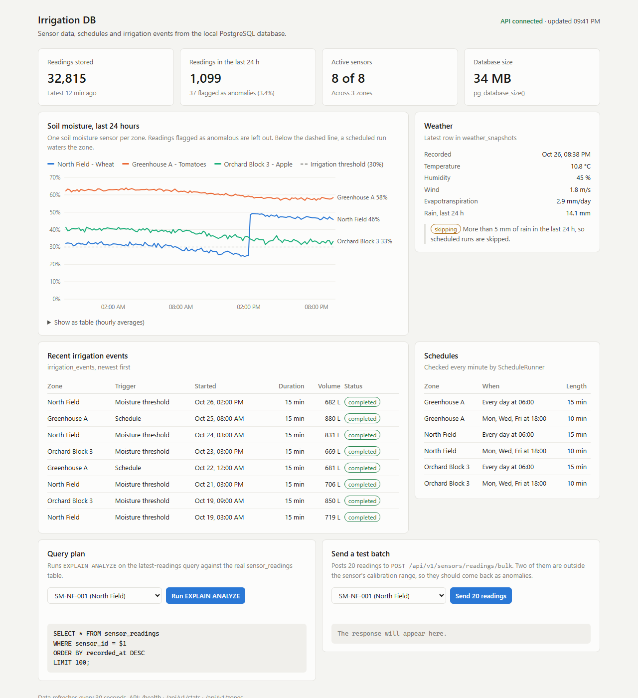
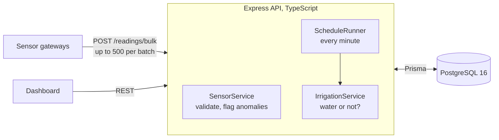
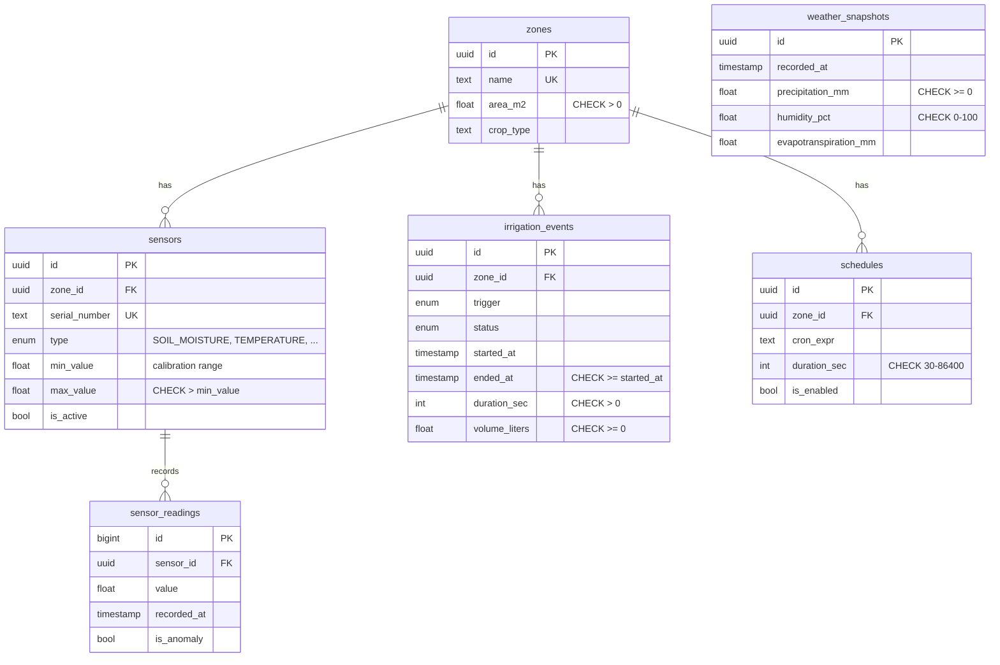

# Irrigation DB

A PostgreSQL database and REST API for sensor-driven irrigation: it ingests soil and weather readings, flags faulty sensors, and waters a zone only when the soil is actually dry and it hasn't rained.





## The problem

A farm has zones (a wheat field, a greenhouse, an orchard block), each with sensors reporting every few minutes. A timer that waters every zone at 06:00 wastes water on days it rained and keeps watering when a broken sensor reports 0% moisture. This project stores the sensor data and makes the watering decision from it:

- Gateways send up to 500 readings per request. Readings from unknown or deactivated sensors are rejected. Out-of-range values are stored but flagged as anomalies. A replayed batch (gateway reconnecting after an outage) is skipped by a unique index instead of being stored twice.
- Every minute, `ScheduleRunner` finds the cron schedules that are due. It skips them if 5 mm or more of rain fell in the last 24 h. Otherwise it waters a zone only if its latest soil moisture is below 30%, and never while the zone is already being watered. Schedules run in the time zone set by `TZ` (UTC by default).
- If half or more of a zone's latest readings are anomalies, auto-irrigation is aborted instead of trusting them.
- Irrigation events are closed automatically when their duration ends. Completing an event by hand is protected against concurrent requests (measured below).
- Six documented queries: daily moisture per zone, zones that need water, water used per week, anomaly rate per sensor, rain vs evapotranspiration, and sensors that have gone quiet.

The sensor data is generated by a seed script that simulates soil drying and watering cycles. No physical hardware is connected.

## Tech stack

PostgreSQL 16 · SQL · Prisma 6 (schema, migrations, client) · TypeScript · Node.js 22 · Express 5 · Zod · Jest + Supertest · Docker Compose · GitHub Actions · ESLint + Prettier

## Run it

You need Docker. One command builds the API, starts PostgreSQL, applies the migrations and loads 30 days of sample data:

```bash
git clone https://github.com/<your-username>/irrigation-db.git
cd irrigation-db
docker compose up -d --build
```

Open http://localhost:3000 for the dashboard. The sample data is only loaded into an empty database, so restarting keeps your data.

For the commands below you also need Node.js 22+ and `npm install`, plus `cp .env.example .env` (the host connects to Postgres on port 5433).

| Command                                                     | What it does                                                      |
| ----------------------------------------------------------- | ----------------------------------------------------------------- |
| `npm test`                                                  | 25 unit tests, no database needed                                 |
| `npm run test:integration`                                  | 12 tests against the real database (creates and removes its data) |
| `npm run reports`                                           | Runs `sql/reports.sql` against the Docker database                |
| `npm run bench`                                             | Index benchmark on 3M rows, writes `docs/benchmark.md`            |
| `npm run db:seed`                                           | Replaces all data with a fresh 30 days ending now                 |
| `npm run lint`, `npm run format:check`, `npm run typecheck` | Static checks                                                     |

pgAdmin: `docker compose --profile tools up -d`, then http://localhost:5050 (admin@irrigation.local / pgadminpassword).

## Database



The schema is normalised to third normal form: zone details live only in `zones`, sensor calibration only in `sensors`, and readings reference a sensor rather than copying its zone. There is one deliberate exception: `sensor_readings.is_anomaly` could be computed from the value and the sensor's calibration range, but it is stored so it doesn't change when a sensor is recalibrated (see design decisions). `weather_snapshots` has no zone key because the seed models one weather source for the whole farm.

**Main indexes** and the queries they serve (sensors also have indexes on `zone_id` and `(type, is_active)` for filtering):

| Index                                                  | Used by                                                                          |
| ------------------------------------------------------ | -------------------------------------------------------------------------------- |
| `sensor_readings (sensor_id, recorded_at DESC)` unique | Latest readings per sensor (dashboard, irrigation decision); duplicate detection |
| `sensor_readings (recorded_at)`                        | Time-window counts and reports across all sensors                                |
| `irrigation_events (zone_id, started_at DESC)`         | Event history per zone                                                           |
| `schedules (zone_id, is_enabled)`                      | Schedules per zone                                                               |
| `weather_snapshots (recorded_at DESC)`                 | Rain in the last 24 h                                                            |

**Constraints.** Foreign keys use `ON DELETE RESTRICT`, so a zone with sensors can't be deleted by accident. The CHECK constraints mirror the Zod validation in the API, so bad rows are rejected even if they are written by a script or a future service that skips the API. If one is hit through the API, it returns `422 CHECK_VIOLATION` with the constraint name. `sensor_readings.value` deliberately has no range check, because out-of-range readings are stored and flagged (see design decisions).

Migrations are in `prisma/migrations/`. The CHECK constraints are raw SQL in the second migration, because Prisma's schema language can't express them.

## Example queries

All six are in [`sql/reports.sql`](sql/reports.sql), with full output in [`docs/queries.md`](docs/queries.md). Two of them:

Zones that need watering now. `DISTINCT ON` takes the newest valid reading per sensor, which the `(sensor_id, recorded_at DESC)` index serves without sorting:

```sql
WITH latest AS (
  SELECT DISTINCT ON (r.sensor_id) r.sensor_id, r.value, r.recorded_at
  FROM sensor_readings r
  WHERE NOT r.is_anomaly
  ORDER BY r.sensor_id, r.recorded_at DESC
)
SELECT z.name AS zone, round(avg(l.value)::numeric, 1) AS latest_moisture_pct, avg(l.value) < 30 AS needs_water
FROM latest l
JOIN sensors s ON s.id = l.sensor_id AND s.type = 'SOIL_MOISTURE' AND s.is_active
JOIN zones z ON z.id = s.zone_id
WHERE NOT EXISTS (SELECT 1 FROM irrigation_events e WHERE e.zone_id = z.id AND e.status = 'ACTIVE')
GROUP BY z.name;
```

```text
          zone           | latest_moisture_pct | needs_water
-------------------------+---------------------+-------------
 Orchard Block 3 - Apple |                33.3 | f
 North Field - Wheat     |                45.9 | f
 Greenhouse A - Tomatoes |                58.5 | f
```

Anomaly rate per sensor over the last 7 days, to spot a sensor that is starting to fail:

```text
 serial_number |     type      | readings | anomalies | anomaly_pct
---------------+---------------+----------+-----------+-------------
 SM-GHA-001    | SOIL_MOISTURE |      952 |        37 |         3.9
 SM-OB3-001    | SOIL_MOISTURE |      970 |        35 |         3.6
 SM-NF-001     | SOIL_MOISTURE |      959 |        34 |         3.5
 ...
```

Output from `npm run reports` on seeded data (2026-10-26). The seed is random, so your numbers will differ.

## Measured results

Every number here comes from a command in this repo.

**Index on the hot query.** `npm run bench` builds a separate 3,000,000-row table (50 sensors x 60,000 readings) and times `SELECT * ... WHERE sensor_id = $1 ORDER BY recorded_at DESC LIMIT 100` with `EXPLAIN ANALYZE`, 300 runs per index, PostgreSQL 16 in Docker on a laptop:

| Index                           | Median (2 runs) | p95 (2 runs) | Plan                                    |
| ------------------------------- | --------------- | ------------ | --------------------------------------- |
| `(sensor_id)`                   | 61.1–70.5 ms    | 86.9–98.9 ms | Bitmap scan of ~60k rows, then sort     |
| `(sensor_id, recorded_at DESC)` | 0.19–0.22 ms    | 0.31–0.36 ms | Index scan that stops after 100 entries |

Both runs show a 99.7% drop in median time; the absolute numbers vary with machine load. The app's index has the same columns and order, declared unique. The latest run's full output and method are in [docs/benchmark.md](docs/benchmark.md).

**Bulk insert.** The same script inserts 100,000 readings through Prisma `createMany` in batches of 1,000: 12.8 s and 14.9 s in the two runs (rolled back afterwards).

**Concurrent completion.** The integration test sends 25 simultaneous requests to complete the same irrigation event. I ran it with the transaction temporarily switched to `READ COMMITTED`, and then with `SERIALIZABLE`:

| Isolation level  | Runs | Requests that completed the event |
| ---------------- | ---- | --------------------------------- |
| `READ COMMITTED` | 6    | 3 to 9 of 25 (the bug)            |
| `SERIALIZABLE`   | 8    | exactly 1 of 25 every time        |

Command: `npx jest -c jest.integration.config.json --runInBand -t simultaneous`

## Design decisions and trade-offs

**Anomalies are stored, not dropped.** A reading outside the sensor's calibration range is saved with `is_anomaly = true`, set at ingest. If the sensor is recalibrated later, old readings keep the flag they arrived with, so history is auditable. The irrigation logic uses the anomaly rate to notice a failing sensor. The cost is that every query that averages values has to filter on `is_anomaly`.

**`SERIALIZABLE` for completing an event.** Completing reads the status and then writes it. Under `READ COMMITTED`, several concurrent requests all see the event as active and all write, as the measurement above shows. Under `SERIALIZABLE`, Postgres aborts the conflicting transactions; the API returns `503 TRANSACTION_DEADLOCK` for those so the client can retry, and `409` if the event was already completed. A single conditional `UPDATE ... WHERE status <> 'COMPLETED'` would also work and avoids retries; I chose the transaction so the read-check-write logic stays in one readable place, and it would extend to more checks.

**Unique key for replay safety.** A gateway that loses its connection resends its last batch. The unique `(sensor_id, recorded_at)` index plus `createMany({ skipDuplicates: true })` makes that a no-op, and the API reports how many rows were duplicates. The same index also serves the latest-readings query, so it costs no extra index.

**Plain PostgreSQL, not TimescaleDB.** Hypertables would suit `sensor_readings` at large volumes, but plain Postgres keeps the setup to a stock Docker image, and with the composite index the hot query stays under a millisecond at 3M rows.

**A small cron matcher instead of a library.** Schedules only need five-field expressions, so `src/modules/schedules/cron.ts` is about 40 tested lines. The runner polls every 15 s but processes each minute once, so a slow tick can't skip or double-run a schedule.

**Modules by domain.** `sensors`, `irrigation`, `schedules`, `weather`, `zones` and `stats` each have their own controller, service, repository and validation. Dependencies are wired by hand in `app.ts`, which keeps the graph easy to follow at this size.

## Tests

- **Unit (25, `npm test`):** ingest rules (anomalies, rejections, duplicates), the irrigation decision (anomaly abort, threshold, already-irrigating), the cron matcher, the schedule runner (due, not due, rain skip, closes finished events, one run per minute), and the error handler's status mapping. Repositories are mocked.
- **Integration (12, `npm run test:integration`):** run against a real PostgreSQL database through the HTTP API: batch ingest and replay, that bulk ingest has its own rate limit, BIGINT serialisation, that the query plan uses the index with no sort step, the concurrent completion race, automatic closing of finished events, and that the CHECK constraints reject bad rows.
- **CI (GitHub Actions):** one job runs format check, lint, typecheck and unit tests. A second starts PostgreSQL, applies the migrations, runs the seed and `sql/reports.sql`, and runs the integration tests.

## API

| Method                   | Path                                  | Description                                                                             |
| ------------------------ | ------------------------------------- | --------------------------------------------------------------------------------------- |
| GET                      | `/health`                             | Liveness check                                                                          |
| GET, POST, PATCH, DELETE | `/api/v1/zones`                       | Zones                                                                                   |
| GET, POST, DELETE        | `/api/v1/sensors`                     | Register, list and deactivate sensors                                                   |
| GET                      | `/api/v1/sensors/:id/readings?limit=` | Latest readings for a sensor                                                            |
| POST                     | `/api/v1/sensors/readings/bulk`       | Batch ingest, up to 500 readings (500 req/min, separate from the 200/min general limit) |
| GET, POST                | `/api/v1/irrigation`                  | Start events, list by zone (`/zones/:zoneId`)                                           |
| PATCH                    | `/api/v1/irrigation/:id/complete`     | Complete an event                                                                       |
| GET, POST                | `/api/v1/weather`                     | Weather snapshots (latest or date range)                                                |
| GET                      | `/api/v1/weather/external?lat=&lon=`  | Proxy to the free Open-Meteo forecast API (no key needed)                               |
| GET, POST, PATCH, DELETE | `/api/v1/schedules`                   | Cron schedules, list by zone (`/zones/:zoneId`)                                         |
| GET                      | `/api/v1/stats`                       | Counts, last-24 h activity, database size                                               |
| GET                      | `/api/v1/stats/query-plan?sensorId=`  | `EXPLAIN ANALYZE` of the latest-readings query                                          |

```bash
curl -X POST http://localhost:3000/api/v1/sensors/readings/bulk \
  -H "Content-Type: application/json" \
  -d '{"readings":[{"sensorId":"<sensor-id>","value":34.2,"recordedAt":"2026-10-22T06:00:00Z"}]}'
# {"data":{"accepted":1,"duplicates":0,"rejected":0,"anomalies":0}}
```

Errors share one shape: `{ "error": { "code": "SENSOR_NOT_FOUND", "message": "...", "meta": {} } }`.

## Project structure

```
prisma/
  schema.prisma          tables, relations, indexes
  migrations/            SQL migrations (CHECK constraints in the second one)
  seed.ts                30 days of simulated sensor data
sql/reports.sql          documented reporting queries
scripts/benchmark-index.ts  index and insert benchmark
public/index.html        dashboard (plain HTML/JS, no build step)
src/
  index.ts               starts the server and the schedule runner
  app.ts                 wires repositories, services and routes
  infrastructure/        Prisma client, logger, rate limiters
  modules/               sensors, irrigation, schedules, weather, zones, stats
  shared/                AppError and the global error handler
tests/
  unit/                  mocked, no database
  integration/           real PostgreSQL through the HTTP API
docs/                    screenshot, benchmark and query output
```

## What I would do next

- Connect a real sensor (for example an Arduino with a soil moisture probe) that posts to the ingest endpoint, so the data isn't simulated.
- Partition `sensor_readings` by month and add a retention policy once it reaches tens of millions of rows.
- Fetch weather on a schedule from a real provider (Open-Meteo has a free API), with one weather source per zone.
- Take a Postgres advisory lock in the schedule runner, so several API instances can't run the same schedule twice.
- Record water volume from the flow sensor when an event closes; today automatically closed events have no volume.
- Authentication, and per-gateway API keys for ingest.

## License

MIT
